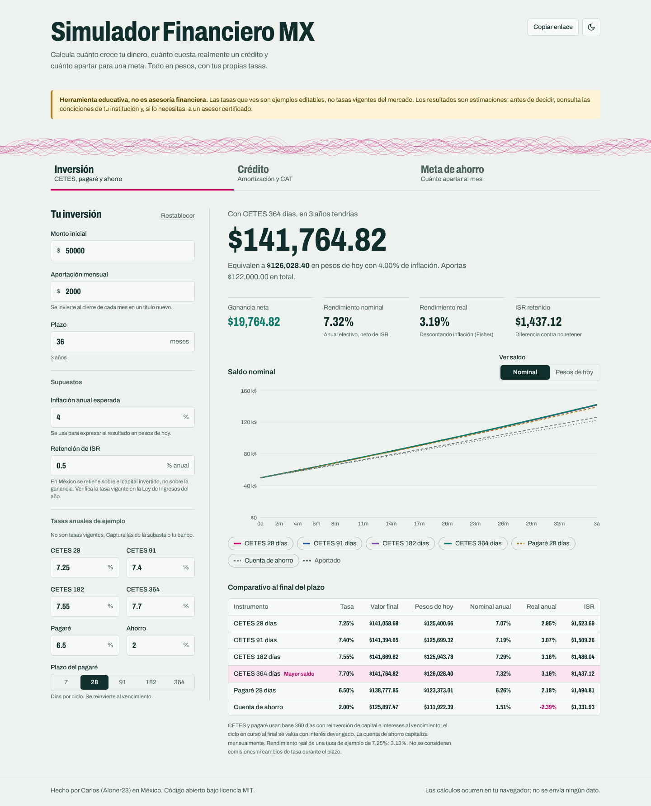
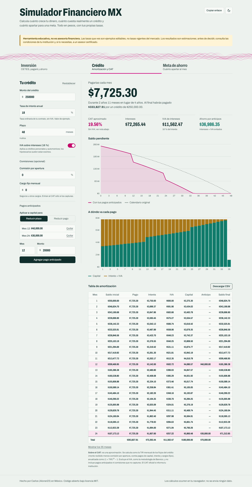
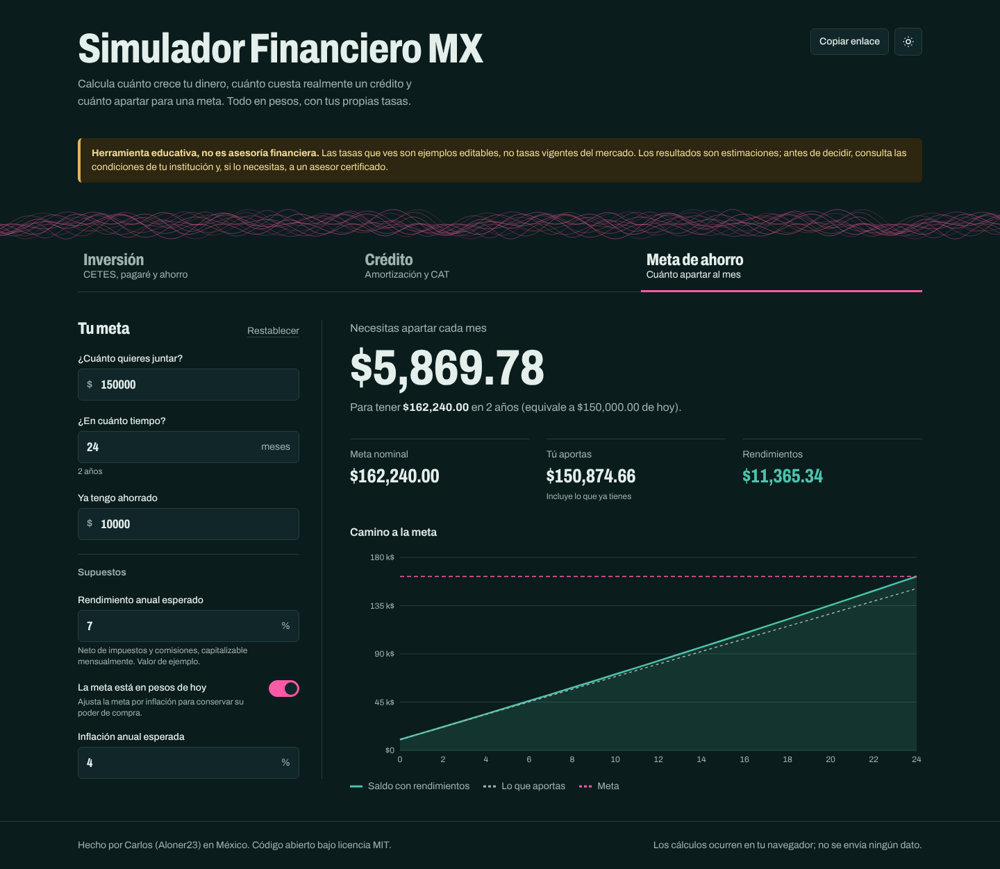
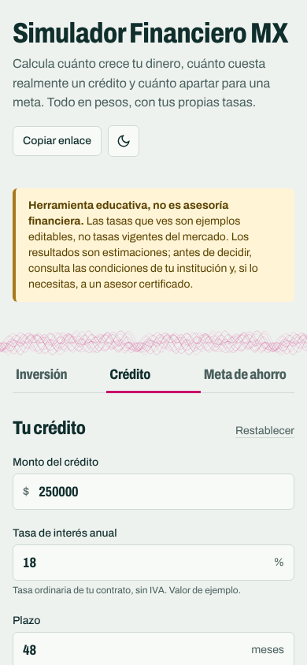

# Simulador Financiero MX

[**Abrir demo sin registro**](https://aloner23.github.io/simulador-financiero-mx/) · [Fórmulas](#fórmulas) · [Arquitectura](#arquitectura) · [Pruebas](#pruebas) · [Inicio rápido](#inicio-rápido)

**Recorrido de 2 minutos:** compara una inversión con tus propias tasas; abre **Crédito**, añade un pago anticipado y revisa cómo cambia la amortización; usa **Copiar enlace** para conservar el escenario. Las tasas precargadas son ejemplos, no cotizaciones vigentes.

[](https://github.com/Aloner23/simulador-financiero-mx/actions/workflows/ci.yml)

Simulador educativo para comparar inversiones en pesos (CETES, pagaré, cuenta de ahorro), entender
cuánto cuesta un crédito de verdad y calcular cuánto apartar para una meta. Todo corre en el navegador
y cada escenario se puede compartir con un enlace.

> **Aviso:** es una herramienta educativa, no asesoría financiera. Las tasas que trae precargadas son
> **ejemplos editables**, no tasas vigentes del mercado. Para decidir, consulta las condiciones de tu
> institución.

**English summary:** _Simulador Financiero MX_ is a Spanish-language, client-side React + TypeScript
app for Mexican personal finance: it compares CETES (28/91/182/364-day, with reinvestment), a generic
bank promissory note and a savings account (nominal vs. inflation-adjusted returns, editable ISR
withholding); builds fixed-payment loan amortization tables with prepayments, optional 16 % VAT on
interest and an IRR-based approximate CAT (annual total cost); and solves for the monthly saving needed
to reach a goal. All finance math lives in pure, unit-tested functions. Scenarios are shareable through
URL query params, the table exports to CSV, and the UI supports dark mode, keyboard navigation and
mobile screens.

## Capturas

| Inversión                                                   | Crédito con pagos anticipados                          |
| ----------------------------------------------------------- | ------------------------------------------------------ |
|  |  |

| Meta de ahorro (modo oscuro)                                       | Móvil                                      |
| ------------------------------------------------------------------ | ------------------------------------------ |
|  |  |

Capturas tomadas con Playwright (Chromium) sobre `npm run build && npx vite preview`.

## Funciones

**Inversión**

- Compara CETES a 28, 91, 182 y 364 días con reinversión al vencimiento, un pagaré bancario
  genérico (7 a 364 días) y una cuenta de ahorro con capitalización mensual.
- Monto inicial, aportación mensual, plazo y tasa de cada instrumento editables.
- Rendimiento nominal y real (ecuación de Fisher) con inflación editable; vista del saldo en pesos de hoy.
- Retención de ISR editable, aplicada sobre el capital como en México, con su impacto en pesos.

**Crédito**

- Tabla de amortización de pago fijo (sistema francés).
- Pagos anticipados a capital con dos estrategias: reducir plazo o reducir pago.
- IVA del 16 % sobre intereses como interruptor (créditos personales y automotrices).
- Comisión por apertura y cargo fijo mensual opcionales.
- CAT aproximado (TIR anualizada, sin IVA) e intereses totales; ahorro por pagos anticipados.
- Exportación de la tabla a CSV (UTF-8 con BOM para que Excel la abra bien).

**Meta de ahorro**

- Aportación mensual necesaria para una meta, con saldo inicial y rendimiento esperado.
- Meta en pesos de hoy (ajustada por inflación) o en pesos nominales.

**Generales**

- Gráficas interactivas (Recharts) con descripción textual para lectores de pantalla.
- Estado completo en la URL (`?h=credito&cmonto=300000&cant=12:40000`) y botón «Copiar enlace».
- Modo claro y oscuro (respeta la preferencia del sistema y recuerda la elección).
- Responsivo, navegable con teclado (pestañas con flechas, foco visible, enlace «Saltar al contenido»).
- Formato `Intl.NumberFormat('es-MX')` para pesos y porcentajes.

## Fórmulas

**Amortización (sistema francés).** Con tasa mensual `i = tasa anual / 12`, monto `P` y `n` pagos:

```
Pago = P · i / (1 − (1 + i)^−n)          (si i = 0: Pago = P / n)
Interés_t = Saldo_{t−1} · i
Capital_t = Pago − Interés_t − IVA_t
```

Con IVA, el pago se calcula con `i · (1 + 0.16)` para que capital + interés + IVA sea constante. En
«reducir pago», tras cada anticipo se recalcula el pago con el saldo y los meses restantes; en «reducir
plazo» el pago se mantiene y el crédito termina antes.

**Rendimiento real (Fisher).** `(1 + nominal) = (1 + real) · (1 + inflación)`, por lo tanto
`real = (1 + nominal) / (1 + inflación) − 1`. No se usa la resta aproximada `nominal − inflación`.

**Inversión.** CETES y pagaré: interés simple por ciclo `r · d / 360`, con reinversión de capital e
intereses al vencimiento. El ISR se retiene como tasa anual sobre el capital: `− isr · d / 365`. El
ciclo en curso al final del plazo se valúa con interés devengado. El rendimiento anual reportado es la
TIR mensual de los flujos (aportaciones y valor final) anualizada.

**CAT aproximado.** TIR mensual de los flujos del crédito, anualizada:

```
0 = (P − comisión apertura) − Σ_{t=1..n} (Pago_t + cargo fijo) / (1 + TIR)^t
CAT ≈ (1 + TIR)^12 − 1
```

Excluye el IVA (como la metodología de Banxico) y sólo incluye las comisiones que captures. Se calcula
sobre el calendario contractual, sin pagos anticipados. El CAT oficial lo publica cada institución.

**Meta de ahorro.** `C = (Meta − S₀(1 + i)^n) · i / ((1 + i)^n − 1)`; si `i = 0`, `C = (Meta − S₀) / n`.

## Arquitectura

```
src/
├── lib/
│   ├── finance/          # Matemática financiera: funciones puras + pruebas
│   │   ├── irr.ts        # VPN, TIR (Newton-Raphson con respaldo de bisección)
│   │   ├── inflation.ts  # Fisher, pesos de hoy ↔ futuros
│   │   ├── investment.ts # CETES / pagaré / ahorro con reinversión e ISR
│   │   ├── credit.ts     # Amortización, anticipos, IVA, CAT aproximado
│   │   └── savings.ts    # Aportación requerida para una meta
│   ├── format.ts         # Intl es-MX
│   ├── csv.ts            # Exportación CSV
│   └── urlState.ts       # Esquemas de estado ↔ query string (con validación y límites)
├── hooks/                # useUrlState, useTheme, useChartColors
├── components/           # Campos accesibles, layout, guilloché
├── features/             # InvestmentTool, CreditTool, SavingsGoalTool
└── App.tsx               # Pestañas, tema, aviso, compartir
```

La UI no hace cálculos: llama a `src/lib/finance`, que no depende de React ni del DOM. Los colores de
las gráficas salen de los mismos tokens CSS que el resto de la interfaz, así que cambian con el tema.

**Diseño.** Inspirado en el papel moneda: fondo «papel» verde frío, tinta jade, rosa mexicano como único
acento y una banda de guilloché (el grabado de seguridad de los billetes) generada con curvas
paramétricas. Las cifras usan Archivo condensado, para que el número sea lo protagonista.

## Inicio rápido

Requiere Node 20.19+ (CI usa Node 22).

```bash
npm install
npm run dev        # http://localhost:5173/simulador-financiero-mx/
```

| Script              | Qué hace                                    |
| ------------------- | ------------------------------------------- |
| `npm run dev`       | Servidor de desarrollo                      |
| `npm run build`     | Typecheck + build de producción en `dist/`  |
| `npm run preview`   | Sirve `dist/` localmente                    |
| `npm test`          | Pruebas unitarias y de componentes (Vitest) |
| `npm run lint`      | ESLint                                      |
| `npm run typecheck` | `tsc --noEmit` (modo estricto)              |
| `npm run format`    | Prettier                                    |

## Pruebas

- **Matemática financiera:** casos de tasa 0 %, un solo periodo, plazo 0, anticipos que liquidan el
  crédito, anticipos repetidos o inválidos, «reducir plazo» contra «reducir pago», sumas cruzadas (capital
  amortizado + anticipos = monto; total pagado = capital + intereses + comisiones), IVA, TIR contra
  anualidades conocidas, Fisher exacto y meta alcanzada exactamente.
- **Referencias independientes** (`reference.test.ts`): pago, intereses, IVA, anticipos, CAT con
  comisiones, CETES con ISR y meta de ahorro contra valores calculados aparte en Python (numpy-financial).
- **Componentes (Testing Library):** navegación por teclado entre pestañas, sincronización con la URL,
  restauración de un escenario compartido, alta de pagos anticipados e interruptor de IVA accesible.

## Despliegue

`.github/workflows/deploy.yml` construye y publica `dist/` en GitHub Pages en cada push a `main`. Para
activarlo: en el repositorio, **Settings → Pages → Source: GitHub Actions**. Vite usa
`base: '/simulador-financiero-mx/'`; si el repositorio se llama distinto, cambia ese valor en
`vite.config.ts`. `.github/workflows/ci.yml` corre lint, formato, typecheck, pruebas y build en cada push
y pull request.

## Hoja de ruta

- Comparar dos créditos lado a lado (p. ej. tasa menor con comisión contra tasa mayor sin comisión).
- Cargar tasas de referencia desde un archivo JSON versionado, con fecha de corte visible.
- Pagos anticipados recurrentes (cada N meses) y aportaciones crecientes con la inflación.
- Exportar a PDF el resumen de un escenario.
- Créditos con tasa variable (TIIE + sobretasa) y simulación de escenarios.
- Separar Recharts en un chunk aparte para reducir la carga inicial.

## Licencia

[MIT](LICENSE) © 2026 Carlos (Aloner23)
